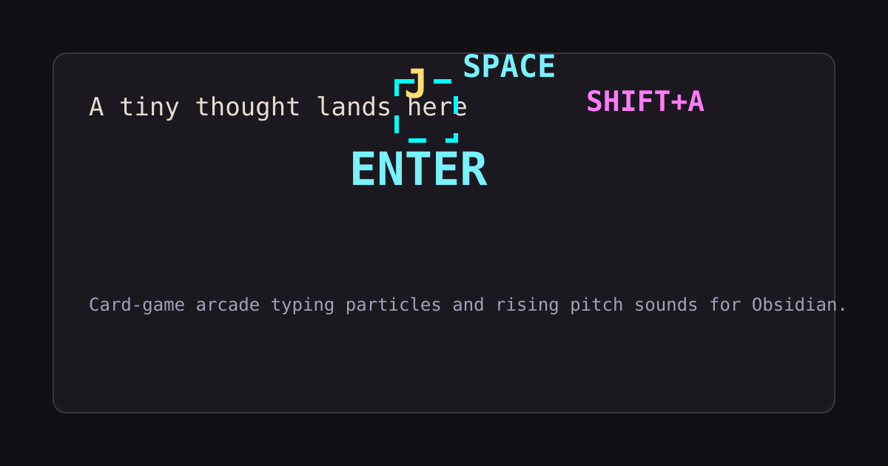
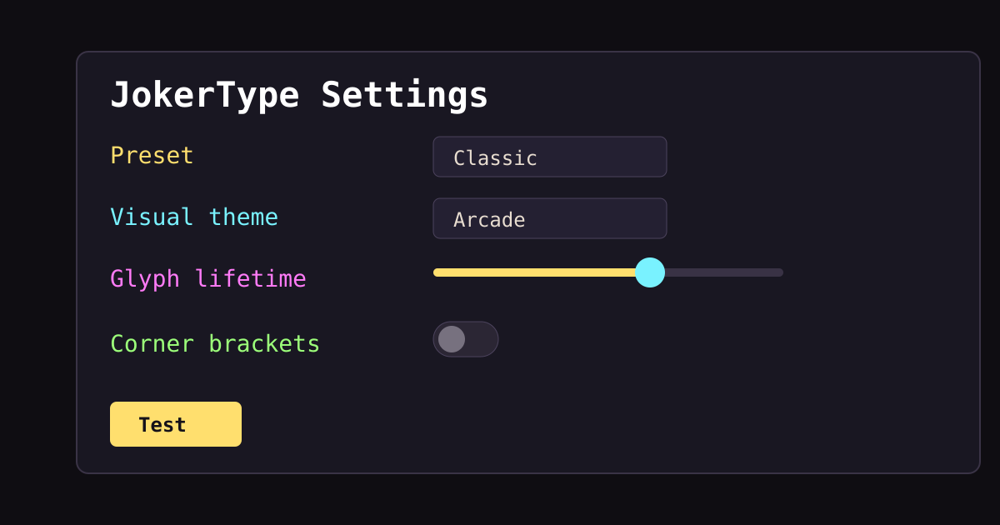

# JokerType

[](https://github.com/kannibalk1w1/jokertype/releases)
[](https://github.com/kannibalk1w1/jokertype/actions/workflows/ci.yml)
[](LICENSE)
[](https://obsidian.md/plugins?id=jokertype)

JokerType is a desktop-first Obsidian plugin that makes typing feel game-like: pixel glyph particles, special-key labels, rising-pitch typing sounds, and configurable visual themes inspired by HyperType and card-game arcade feedback.

**[Install JokerType in Obsidian](obsidian://show-plugin?id=jokertype)** · **[View releases](https://github.com/kannibalk1w1/jokertype/releases)** · **[Report an issue](https://github.com/kannibalk1w1/jokertype/issues/new/choose)**



## Features

- Floating pixel text for typed characters, `SPACE`, `ENTER`, `TAB`, `BACKSPACE`, `DELETE`, and paste.
- HyperType-style sampled sounds with pitch rising during fast typing streaks.
- Visual themes: Arcade, Neon, Monochrome, Terminal, and Prism.
- Prism theme and preset: stable jewel colors per glyph, with clear special-key colors and no editor shake.
- Optional Markdown Moments celebrate meaningful note structure with card-style effects; choose Essentials, Full Deck, or a custom selection.
- Presets: Subtle, Classic, Chaotic, Prism, and Sound only.
- Fine-grained toggles for text glyphs, enter effects, delete effects, corner brackets, editor shake, and status combo counter.
- Controls for volume, sound style, effect intensity, glyph lifetime, reduced motion, and large paste throttling.
- Custom typing, Space, Enter, Backspace/Delete, and Paste sound uploads stored in Obsidian plugin data.
- Max pitch, pitch rise, and reset controls for tuning typing streaks.
- Command palette support for `Toggle JokerType`, which can be assigned a hotkey in Obsidian's Hotkeys settings.
- Test effect button for quick tuning.



## Installation

### Community plugins

Open **Settings → Community plugins**, search for **JokerType**, install it, then enable it.

### Manual install

Copy the built plugin folder into:

```text
<vault>/.obsidian/plugins/jokertype
```

Then enable Community plugins and turn on JokerType.

## Settings

Start with `Classic`, then tune from there. `Subtle` is calmer for long writing sessions, `Prism` adds colorful but steady feedback, `Chaotic` is intentionally loud and flashy, and `Sound only` keeps the audio streak feel without visual particles.

Use `Glyph lifetime` to tune how long particles remain visible. Disable `Corner brackets` if the bracket bursts feel too busy.

Turn on `Markdown Moments` to celebrate note-making actions without tracking your vault. `Essentials` includes headings (`TITLE!`), wiki links (`LINKED`), new tasks (`QUEST`), and checked tasks (`CLEARED`). `Full Deck` adds note embeds, callouts, closed code blocks, footnotes, closed frontmatter, and table dividers; every Moment can be toggled individually. Pasted text stays quiet.

## Privacy and permissions

JokerType does not use telemetry, ads, analytics, accounts, network requests, or external file access. It observes editor transactions inside Obsidian, stores plugin settings and optional uploaded custom sound data with Obsidian's plugin data API, and plays local embedded or user-provided audio assets.

## Development

Install dependencies:

```bash
npm install
```

Run tests:

```bash
npm test
```

Build:

```bash
npm run build
```

Please see [CONTRIBUTING.md](CONTRIBUTING.md) before opening a pull request.

## Credits

JokerType uses HyperType as an implementation reference and includes attributed HyperType font and sound assets. See [THIRD_PARTY_NOTICES.md](THIRD_PARTY_NOTICES.md).

## Changelog

See [CHANGELOG.md](CHANGELOG.md).
